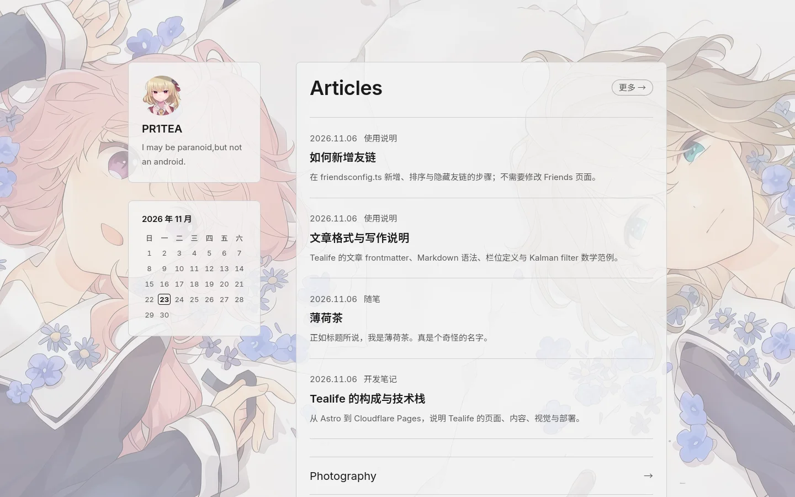
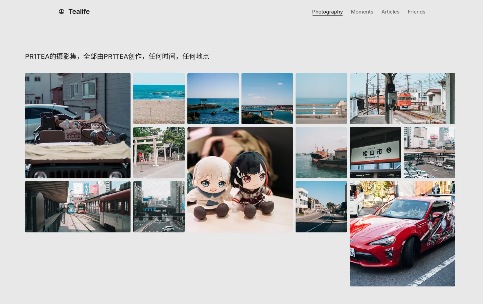
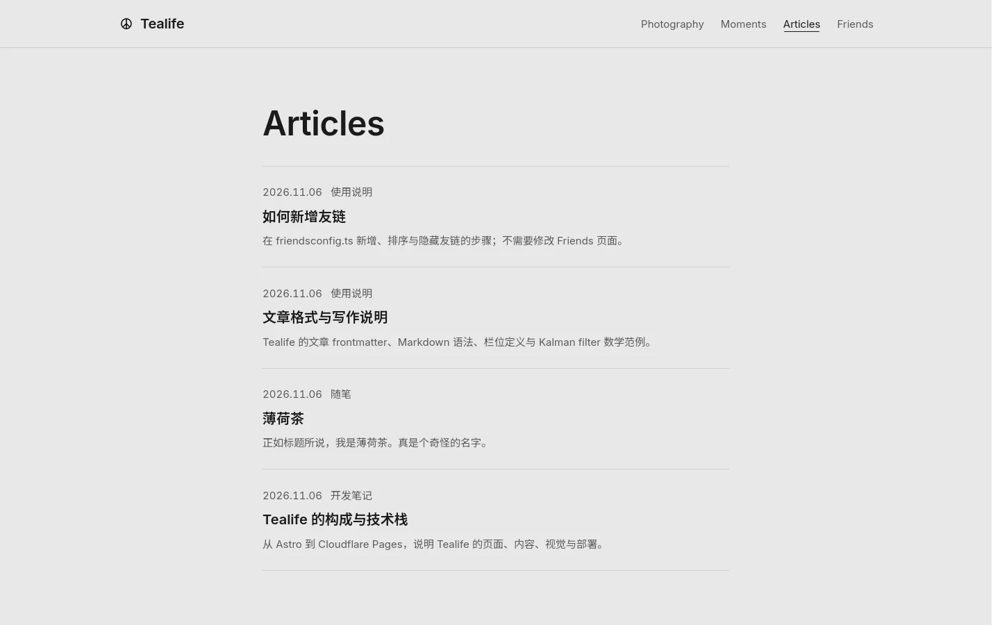
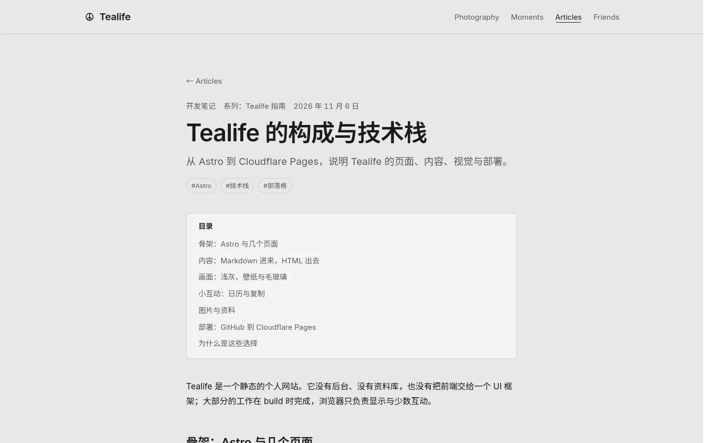

<div align="center">
  
</div>

<h1 align="center">Tealife</h1>

<p align="center">
  <strong>摄影、动态与文字 — PR1TEA 的个人网站</strong><br />
  <sub>Photography, moments, and writing — a personal website by PR1TEA.</sub>
</p>

<p align="center">
  <a href="https://astro.build"></a>
  <a href="https://www.typescriptlang.org/"></a>
  <a href="https://pnpm.io/"></a>
  <a href="https://nodejs.org/"></a>
  <a href="https://pages.cloudflare.com/"></a>
  <a href="LICENSE"></a>
</p>

<p align="center">
  <a href="#简体中文"><strong>简体中文</strong></a> · <a href="#english">English</a>
</p>

<p align="center">
  <a href="#预览">预览</a> ·
  <a href="#功能">功能</a> ·
  <a href="#技术栈">技术栈</a> ·
  <a href="#开始使用">开始使用</a> ·
  <a href="#部署">部署</a> ·
  <a href="https://github.com/PR1TEA">GitHub</a>
</p>

## 简体中文

> _Даже в тяжести самых крутых перемен..._

**Tealife** 是 PR1TEA 的个人网站，用来放置摄影、生活动态与文章。它使用 Astro 构建，内容以 Markdown 维护，构建时输出纯静态页面；没有数据库、后台、会员系统或服务器端运行时。

设计目标很简单：保持简洁、可整理、容易长期保存。想改的时候，直接改源码。就像文章里写的那样——_Just for fun._

<details>
<summary>目录</summary>

- [预览](#预览)
- [功能](#功能)
- [技术栈](#技术栈)
- [项目结构](#项目结构)
- [开始使用](#开始使用)
- [写内容](#写内容)
- [配置](#配置)
- [部署](#部署)
- [设计](#设计)
- [授权](#授权)
- [联系](#联系)

</details>

### 预览

<p align="center">
  
</p>

<table>
  <tr>
    <td width="50%" align="center">
      
      <br />
      <sub>个人名片、日历与最新文章</sub>
    </td>
    <td width="50%" align="center">
      
      <br />
      <sub>摄影相册</sub>
    </td>
  </tr>
  <tr>
    <td width="50%" align="center">
      
      <br />
      <sub>文章列表</sub>
    </td>
    <td width="50%" align="center">
      
      <br />
      <sub>文章内页与自动目录</sub>
    </td>
  </tr>
</table>

<p align="center">
  
  <br />
  <sub>移动端布局与独立壁纸</sub>
</p>

### 功能

| 模块            | 说明                                                                                                                                           |
| --------------- | ---------------------------------------------------------------------------------------------------------------------------------------------- |
| **Photography** | 从 `images/photography/` 自动读取照片，按文件名自然排序（`P1`、`P2`、`P10`），用 Astro `<Image>` 输出 640px 宽版本，并以混合尺寸瓷砖网格展示。 |
| **Moments**     | 以时间轴呈现简短的 Markdown 记录，frontmatter 只需要 `pubDate`。                                                                               |
| **Articles**    | 基于 Content Collections 的文章系统，支持分类、系列、标签、封面、自动目录、KaTeX 数学公式、Shiki 代码高亮与 GFM 表格。                         |
| **Friends**     | 由 `src/config/friendsconfig.ts` 管理友链，支持权重排序与 `enabled` 开关。                                                                     |
| **RSS**         |  构建时生成 `/rss.xml`，供阅读器订阅。                              |
| **首页**        | 满屏壁纸 hero、俄语标题、RSS / Email 复制按钮、GitHub 链接、个人名片、当月日历、最新五篇文章与 Photography 入口。                              |

#### 文章能力

- **Frontmatter 校验**：`title`、`description`、`pubDate`、`category` 必填；`updatedDate`、`series`、`seriesOrder`、`tags`、`cover`、`coverAlt` 可选。
- **自动目录**：文章页会收集 `##` 与 `###` 标题生成 TOC。
- **数学公式**：行内 `$...$` 与区块 `$$...$$` 由 KaTeX 渲染。
- **代码高亮**：Shiki 处理代码块，使用 `github-light` / `github-dark` 两套主题。
- **图片管线**：文章封面通过 `image()` schema 交给 Astro 图片管线；正文图片使用相对路径引用。
- **本地日期**：首页日历使用浏览器本地时区，自动高亮今天。

#### 设计细节

- 浅灰主题：背景 `#e7e7e7`，面板 `#f3f3f3`，文字 `#1b1b1b`。
- 桌面与移动端使用不同壁纸；面板使用半透明背景与 `backdrop-filter` 毛玻璃效果。
- 字体：Inter Variable、Noto Sans SC Variable、JetBrains Mono Variable。
- 使用原生 CSS / JavaScript：Grid、Flexbox、CSS 变量、日历和复制按钮，不引入前端 UI 框架。
- 支持键盘操作、跳至主内容、`focus-visible` 与 `prefers-reduced-motion`。
- 目前只有浅色主题。

### 技术栈

<p align="center">
  &nbsp;
  &nbsp;
  &nbsp;
  &nbsp;
  &nbsp;
  &nbsp;
  &nbsp;
  
</p>

| 技术                      | 版本        | 在 Tealife 中的角色                                           |
| ------------------------- | ----------- | ------------------------------------------------------------- |
| **Astro**                 | `^7.4.5`    | 静态站点生成、Content Collections、图片优化与 Markdown 管线。 |
| **TypeScript**            | `^5.9.3`    | 严格类型检查，继承 `astro/tsconfigs/strict`。                 |
| **pnpm**                  | `10.33.0`   | 包管理与锁文件；`packageManager` 已固定版本。                 |
| **Node.js**               | `>=22.23.4` | 构建运行时；`.npmrc` 固定 `24.11.1`。                         |
| **Markdown / GFM**        | —           | 文章与动态内容，支持表格、列表、引用等。                      |
| **KaTeX**                 | `^0.19.1`   | 通过 `remark-math` + `rehype-katex` 渲染数学公式。            |
| **Shiki**                 | Astro 内置  | 代码语法高亮，使用 GitHub 明暗两套主题。                      |
| **Prettier**              | `^3.9.10`   | 代码与 Markdown 格式化，配合 `prettier-plugin-astro`。        |
| **原生 CSS / JavaScript** | —           | 布局、日历、复制按钮与少量交互，无 UI 框架。                  |
| **Cloudflare Pages**      | —           | 从 GitHub 触发构建，部署 `dist/` 静态文件。                   |

字体来自 Fontsource：**Inter Variable**、**Noto Sans SC Variable**、**JetBrains Mono Variable**。

### 项目结构

```text
Tealife/
├── .github/
│   └── assets/             # README 截图、logo 与技术栈图标
├── images/
│   ├── decorative/         # 头像、桌面/移动壁纸、favicon
│   └── photography/        # 相册照片
├── src/
│   ├── components/         # SiteHeader、SiteFooter、ProfileCard、Calendar、ArticleList
│   ├── config/             # site.ts、profile.ts、friendsconfig.ts
│   ├── content/
│   │   ├── articles/       # 文章 Markdown
│   │   └── moments/        # 动态 Markdown
│   ├── layouts/            # BaseLayout、ArticleLayout
│   ├── pages/              # 路由与 /rss.xml
│   ├── styles/             # global.css、prose.css
│   ├── utils/              # date.ts
│   └── content.config.ts   # Content Collections schema
├── .npmrc
├── .prettierrc.mjs
├── astro.config.mjs
├── package.json
├── pnpm-lock.yaml
├── tsconfig.json
├── LICENSE
└── README.md
```

`src/content/photography/` 只是保留目录；相册实际读取 `images/photography/`。`dist/`、`node_modules/`、`.astro/`、`.cache/` 等为生成目录，不纳入版本控制。

### 开始使用

#### 环境要求

- Node.js `>=22.23.4`（`.npmrc` 固定 `24.11.1`）
- pnpm `10.33.0`

#### 本地运行

```bash
pnpm install
pnpm dev       # 启动开发服务器
pnpm build     # 构建到 dist/
pnpm preview   # 预览生产构建
pnpm check     # Astro / TypeScript 检查
pnpm format    # Prettier 格式化
pnpm format:check
```

### 写内容

#### 文章

在 `src/content/articles/` 新增 `.md` 文件，文件名就是路由 slug。例如 `mint-tea.md` 对应 `/articles/mint-tea/`。正文从 `##` 开始，不要重复写 `#` 标题。

```yaml
---
title: '文章标题'
description: '简短摘要'
pubDate: 2026-11-20
category: 'Writing'
tags: ['Notes']
# 可选
# updatedDate: 2026-11-21
# series: "Tealife 指南"
# seriesOrder: 1
# cover: ./images/cover.jpg
# coverAlt: "封面图片说明"
---
```

- **必填**：`title`、`description`、`pubDate`、`category`。
- **可选**：`updatedDate`、`series`、`seriesOrder`、`tags`、`cover`、`coverAlt`。
- `##` 与 `###` 会进入文章目录。
- 支持 `$...$` / `$$...$$` 数学公式、GFM 表格与带语言标签的代码块。
- 文章图片可以放在 `src/content/articles/images/`（不存在时新建），用相对路径引用；封面通过 frontmatter 的 `cover` 设置。

#### 动态

在 `src/content/moments/` 新增 `.md`，frontmatter 只需要 `pubDate`，其余写正文即可。

#### 摄影

把 AVIF、JPG、JPEG、PNG 或 WebP 放进 `images/photography/`。文件名按自然顺序排序，例如 `P1`、`P2`、`P10`。页面会自动收集并交给 Astro `<Image>` 处理。

#### 友链

编辑 `src/config/friendsconfig.ts` 的 `friendsConfig`：

```ts
{
  title: '朋友名称',
  imgurl: 'https://example.com/avatar.png',
  desc: '一句简介',
  siteurl: 'https://example.com/',
  tags: ['Blog'],
  weight: 10,
  enabled: true,
}
```

`weight` 越大越靠前；`enabled: false` 会隐藏该项；`tags` 目前只用于整理，不显示在页面上。

### 配置

| 文件                          | 用途                                                       |
| ----------------------------- | ---------------------------------------------------------- |
| `src/config/site.ts`          | 站点名称、正式 URL、描述、语言、开始日期（预留）与导航项。 |
| `src/config/profile.ts`       | 首页名片的名称、头像、简介与链接。                         |
| `src/config/friendsconfig.ts` | 友链内容与排序。                                           |
| `src/content.config.ts`       | `articles`、`moments` 的 Content Collections schema。      |
| `astro.config.mjs`            | Markdown 处理器、KaTeX 与 Shiki 配置。                     |

`SITE.lang` 会同时影响 `<html lang>` 与 RSS 的 `<language>`，请与站点主要语言保持一致。`SITE.startDate` 目前是预留字段，尚未被页面读取。

### 部署

Tealife 是纯静态站点，推荐使用 **Cloudflare Pages**：

| 设置                   | 值           |
| ---------------------- | ------------ |
| Framework preset       | Astro        |
| Build command          | `pnpm build` |
| Build output directory | `dist`       |
| Root directory         | 仓库根目录   |
| Node.js version        | `24.11.1`    |
| pnpm version           | `10.33.0`    |

不需要 `@astrojs/cloudflare` adapter，也不需要服务器运行时。Cloudflare Pages 会从 GitHub 拉取仓库、安装依赖、执行构建并发布 `dist/`。

部署前请在 `src/config/site.ts` 中填写：

- `SITE.url`：正式网址，建议使用自定义域名作为 canonical。
- `SITE.description`：站点描述，用于 meta description 与 RSS。

如果 `SITE.url` 留空，RSS 中的文章链接可能会是相对路径。`.npmrc` 还配置了 Node 下载镜像；如果构建时下载 Node 停滞，可以检查该镜像与 Pages 的 `NODE_VERSION` 设置。

### 设计

Tealife 的视觉以浅灰、壁纸和半透明面板为主：

- 页面背景 `#e7e7e7`，面板 `#f3f3f3`，文字 `#1b1b1b`。
- 首页 hero 与内容区共享壁纸，通过遮罩控制亮度；卡片使用 `backdrop-filter` 做毛玻璃。
- 桌面和移动端使用不同壁纸；布局差异主要是栏数与 hero 背景，而不是两套页面。
- 排版由 `global.css` 的容器、间距与字号变量控制；`prose.css` 只处理文章正文。
- 没有前端 UI 框架，交互由原生 JavaScript 完成。
- 只有浅色主题，支持 `prefers-reduced-motion`、键盘焦点与跳转链接。

### 授权

- **代码**：[GNU GPL v3.0](LICENSE)（GPL-3.0-only）。
- **文章、动态与原创摄影作品**：不因代码采用 GPL 而自动适用 GPL；未经同意请勿转载或重用。
- **第三方素材与依赖**：遵循各自授权。
- **技术栈图标**：来自 [Simple Icons](https://simpleicons.org/)（CC0 1.0）；各商标归其所有者所有。
- 版权标示：`Tealife / Copyright (C) 2026 PR1TEA`。

### 联系

- GitHub：[PR1TEA](https://github.com/PR1TEA)
- Email：[PR1TEA@icloud.com](mailto:PR1TEA@icloud.com)
- RSS：`/rss.xml`

欢迎通过 GitHub Issues 或 Pull Requests 反馈问题、提出改进建议。

---

## English

<details>
<summary>Contents</summary>

- [Overview](#overview)
- [Preview](#preview)
- [Features](#features)
- [Tech Stack](#tech-stack)
- [Project Structure](#project-structure)
- [Getting Started](#getting-started)
- [Writing Content](#writing-content)
- [Configuration](#configuration)
- [Deployment](#deployment)
- [Design](#design)
- [License](#license)
- [Contact](#contact)

</details>

### Overview

**Tealife** is PR1TEA's personal website for photography, moments, and writing. Built with Astro, it keeps most content in Markdown and generates a fully static site at build time. There is no database, admin panel, account system, or server-side runtime.

The goal is simple: keep the site small, easy to organize, and easy to preserve. If something needs changing, change the source. As the site itself puts it — _Just for fun._

> _Даже в тяжести самых крутых перемен..._

### Preview

<p align="center">
  
</p>

<table>
  <tr>
    <td width="50%" align="center">
      
      <br />
      <sub>Profile, calendar, and recent articles</sub>
    </td>
    <td width="50%" align="center">
      
      <br />
      <sub>Photography gallery</sub>
    </td>
  </tr>
  <tr>
    <td width="50%" align="center">
      
      <br />
      <sub>Article list</sub>
    </td>
    <td width="50%" align="center">
      
      <br />
      <sub>Article page and automatic table of contents</sub>
    </td>
  </tr>
</table>

<p align="center">
  
  <br />
  <sub>Mobile layout with its own wallpaper</sub>
</p>

### Features

| Section         | Description                                                                                                                                                                       |
| --------------- | --------------------------------------------------------------------------------------------------------------------------------------------------------------------------------- |
| **Photography** | Loads photos from `images/photography/`, sorts them naturally (`P1`, `P2`, `P10`), outputs 640px-wide versions with Astro `<Image>`, and lays them out in a mixed-size tile grid. |
| **Moments**     | Short Markdown entries in a timeline; only `pubDate` is required in the frontmatter.                                                                                              |
| **Articles**    | A Content Collections-based article system with categories, series, tags, covers, an automatic table of contents, KaTeX math, Shiki syntax highlighting, and GFM tables.          |
| **Friends**     | Friend links managed in `src/config/friendsconfig.ts`, with weight sorting and an `enabled` toggle.                                                                               |
| **RSS**         |  Generates `/rss.xml` at build time for feed readers.                                                  |
| **Home**        | Full-screen wallpaper hero, Russian quote, RSS and Email copy buttons, GitHub link, profile card, current-month calendar, five recent articles, and a Photography entry.          |

#### Article capabilities

- **Frontmatter validation**: `title`, `description`, `pubDate`, and `category` are required; `updatedDate`, `series`, `seriesOrder`, `tags`, `cover`, and `coverAlt` are optional.
- **Automatic TOC**: generated from `##` and `###` headings.
- **Math**: inline `$...$` and block `$$...$$` rendered by KaTeX.
- **Syntax highlighting**: Shiki with the `github-light` and `github-dark` themes.
- **Images**: covers use the `image()` schema and Astro's image pipeline; body images use relative paths.
- **Local date**: the homepage calendar uses the visitor's local timezone and highlights today.

#### Design details

- Light-gray palette: background `#e7e7e7`, surface `#f3f3f3`, text `#1b1b1b`.
- Different wallpapers for desktop and mobile; translucent panels with `backdrop-filter`.
- Fonts: Inter Variable, Noto Sans SC Variable, and JetBrains Mono Variable.
- Vanilla CSS and JavaScript: Grid, Flexbox, CSS variables, the calendar, and copy buttons; no UI framework.
- Keyboard support, skip link, `focus-visible`, and `prefers-reduced-motion`.
- Light theme only.

### Tech Stack

<p align="center">
  &nbsp;
  &nbsp;
  &nbsp;
  &nbsp;
  &nbsp;
  &nbsp;
  &nbsp;
  
</p>

| Technology                   | Version          | Role in Tealife                                                                             |
| ---------------------------- | ---------------- | ------------------------------------------------------------------------------------------- |
| **Astro**                    | `^7.4.5`         | Static site generation, Content Collections, image optimization, and the Markdown pipeline. |
| **TypeScript**               | `^5.9.3`         | Strict type checking via `astro/tsconfigs/strict`.                                          |
| **pnpm**                     | `10.33.0`        | Package management and lockfile; pinned in `packageManager`.                                |
| **Node.js**                  | `>=22.23.4`      | Build runtime; `.npmrc` pins `24.11.1`.                                                     |
| **Markdown / GFM**           | —                | Articles and moments, including tables, lists, and blockquotes.                             |
| **KaTeX**                    | `^0.19.1`        | Math rendering through `remark-math` and `rehype-katex`.                                    |
| **Shiki**                    | Built into Astro | Syntax highlighting with the GitHub light and dark themes.                                  |
| **Prettier**                 | `^3.9.10`        | Code and Markdown formatting with `prettier-plugin-astro`.                                  |
| **Vanilla CSS / JavaScript** | —                | Layout, calendar, copy buttons, and small interactions; no UI framework.                    |
| **Cloudflare Pages**         | —                | GitHub-triggered builds that deploy the static `dist/` output.                              |

Fonts are provided by Fontsource: **Inter Variable**, **Noto Sans SC Variable**, and **JetBrains Mono Variable**.

### Project Structure

```text
Tealife/
├── .github/
│   └── assets/             # README screenshots, logo, and tech icons
├── images/
│   ├── decorative/         # avatar, desktop/mobile wallpapers, favicon
│   └── photography/        # gallery photos
├── src/
│   ├── components/         # SiteHeader, SiteFooter, ProfileCard, Calendar, ArticleList
│   ├── config/             # site.ts, profile.ts, friendsconfig.ts
│   ├── content/
│   │   ├── articles/       # article Markdown
│   │   └── moments/        # moment Markdown
│   ├── layouts/            # BaseLayout, ArticleLayout
│   ├── pages/              # routes and /rss.xml
│   ├── styles/             # global.css, prose.css
│   ├── utils/              # date.ts
│   └── content.config.ts   # Content Collections schema
├── .npmrc
├── .prettierrc.mjs
├── astro.config.mjs
├── package.json
├── pnpm-lock.yaml
├── tsconfig.json
├── LICENSE
└── README.md
```

`src/content/photography/` is a reserved directory; the gallery actually reads `images/photography/`. Generated directories such as `dist/`, `node_modules/`, `.astro/`, and `.cache/` are not committed.

### Getting Started

#### Requirements

- Node.js `>=22.23.4` (`.npmrc` pins `24.11.1`)
- pnpm `10.33.0`

#### Local development

```bash
pnpm install
pnpm dev       # start the development server
pnpm build     # build to dist/
pnpm preview   # preview the production build
pnpm check     # Astro / TypeScript checks
pnpm format    # format with Prettier
pnpm format:check
```

### Writing Content

#### Articles

Add a `.md` file to `src/content/articles/`; the filename becomes the route slug. For example, `mint-tea.md` maps to `/articles/mint-tea/`. Start the body with `##`; do not repeat the `#` title.

```yaml
---
title: 'Article title'
description: 'Short summary'
pubDate: 2026-11-20
category: 'Writing'
tags: ['Notes']
# optional
# updatedDate: 2026-11-21
# series: "Tealife Guide"
# seriesOrder: 1
# cover: ./images/cover.jpg
# coverAlt: "Cover description"
---
```

- **Required**: `title`, `description`, `pubDate`, and `category`.
- **Optional**: `updatedDate`, `series`, `seriesOrder`, `tags`, `cover`, and `coverAlt`.
- `##` and `###` headings feed the table of contents.
- Supports `$...$` and `$$...$$` math, GFM tables, and fenced code blocks with language tags.
- Put article images in `src/content/articles/images/` (create it if needed) and reference them with relative paths; set covers through the frontmatter `cover` field.

#### Moments

Add a `.md` file to `src/content/moments/`; only `pubDate` is required in the frontmatter. The rest is the Markdown body.

#### Photography

Drop AVIF, JPG, JPEG, PNG, or WebP images into `images/photography/`. Filenames are naturally sorted (`P1`, `P2`, `P10`), and Astro `<Image>` processes them automatically.

#### Friends

Edit `friendsConfig` in `src/config/friendsconfig.ts`:

```ts
{
  title: 'Friend name',
  imgurl: 'https://example.com/avatar.png',
  desc: 'A short description',
  siteurl: 'https://example.com/',
  tags: ['Blog'],
  weight: 10,
  enabled: true,
}
```

Higher `weight` values appear first; `enabled: false` hides an entry; `tags` are for organization only and are not rendered.

### Configuration

| File                          | Purpose                                                                                 |
| ----------------------------- | --------------------------------------------------------------------------------------- |
| `src/config/site.ts`          | Site name, canonical URL, description, language, start date (reserved), and navigation. |
| `src/config/profile.ts`       | Homepage profile name, avatar, bio, and links.                                          |
| `src/config/friendsconfig.ts` | Friend links and ordering.                                                              |
| `src/content.config.ts`       | Content Collections schemas for `articles` and `moments`.                               |
| `astro.config.mjs`            | Markdown processor, KaTeX, and Shiki configuration.                                     |

`SITE.lang` affects both `<html lang>` and the RSS `<language>` value; keep it consistent with the site's primary language. `SITE.startDate` is currently reserved and is not read by any page.

### Deployment

Tealife is a fully static site. **Cloudflare Pages** is the recommended target:

| Setting                | Value           |
| ---------------------- | --------------- |
| Framework preset       | Astro           |
| Build command          | `pnpm build`    |
| Build output directory | `dist`          |
| Root directory         | Repository root |
| Node.js version        | `24.11.1`       |
| pnpm version           | `10.33.0`       |

No `@astrojs/cloudflare` adapter or server runtime is required. Cloudflare Pages pulls the repository from GitHub, installs dependencies, builds the site, and publishes `dist/`.

Before deploying, set these in `src/config/site.ts`:

- `SITE.url`: the production URL, preferably a custom domain used as the canonical URL.
- `SITE.description`: the site description used for the meta description and RSS.

If `SITE.url` is empty, RSS item links may be relative. `.npmrc` also configures a Node download mirror; if installs stall during deployment, check that mirror and the Pages `NODE_VERSION` setting.

### Design

Tealife's visual language is built around light gray, wallpaper, and translucent panels:

- Page background `#e7e7e7`, surface `#f3f3f3`, text `#1b1b1b`.
- The hero and content area share the same wallpaper, with an overlay controlling brightness; cards use `backdrop-filter` for a frosted-glass effect.
- Desktop and mobile use different wallpapers; layout differences are mostly column count and hero background, not separate pages.
- Layout tokens live in `global.css`; `prose.css` only handles article body styles.
- No frontend UI framework; interactions are implemented in vanilla JavaScript.
- Light theme only, with `prefers-reduced-motion`, keyboard focus, and skip-link support.

### License

- **Code**: [GNU GPL v3.0](LICENSE) (GPL-3.0-only).
- **Articles, moments, and original photographs**: not automatically covered by the code license; do not republish or reuse them without permission.
- **Third-party assets and dependencies**: covered by their respective licenses.
- **Tech stack icons**: from [Simple Icons](https://simpleicons.org/) (CC0 1.0); trademarks belong to their respective owners.
- Copyright notice: `Tealife / Copyright (C) 2026 PR1TEA`.

### Contact

- GitHub: [PR1TEA](https://github.com/PR1TEA)
- Email: [PR1TEA@icloud.com](mailto:PR1TEA@icloud.com)
- RSS: `/rss.xml`

Bug reports and improvement suggestions are welcome through GitHub Issues and Pull Requests.
